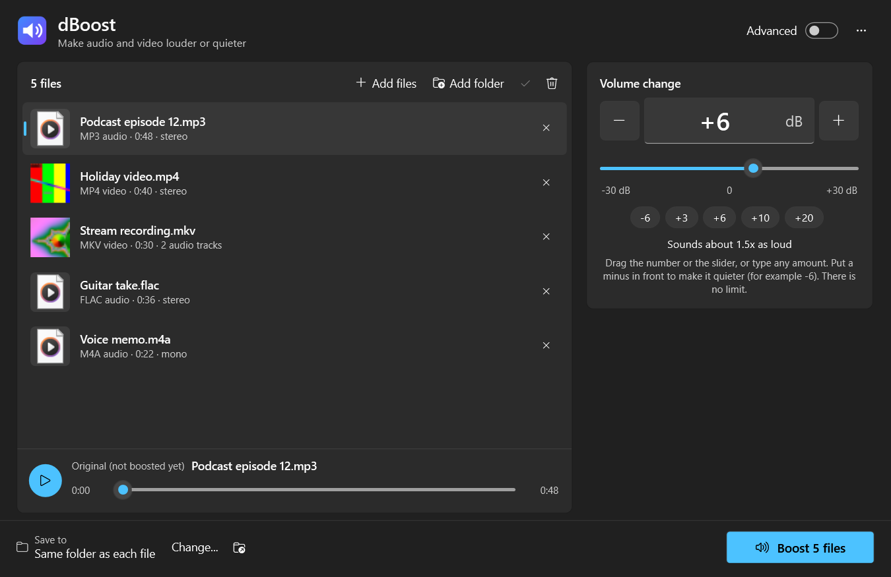
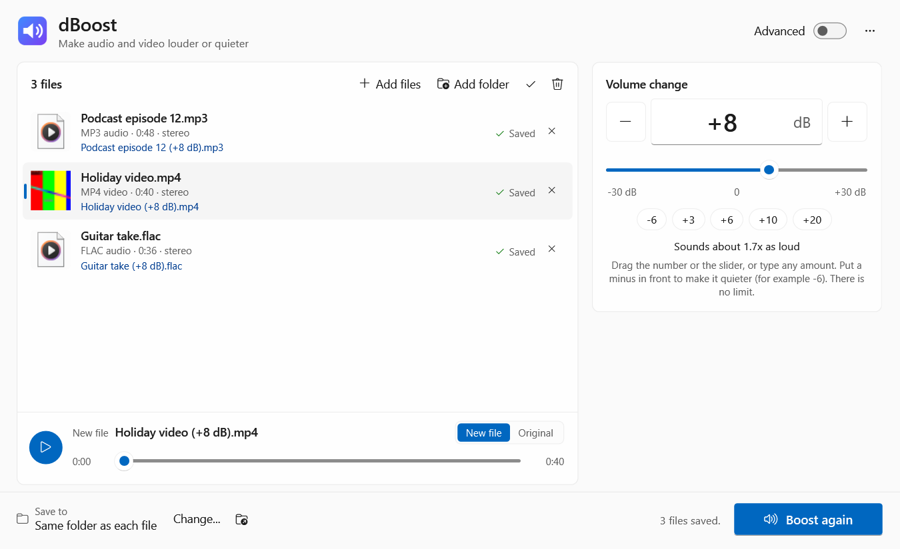
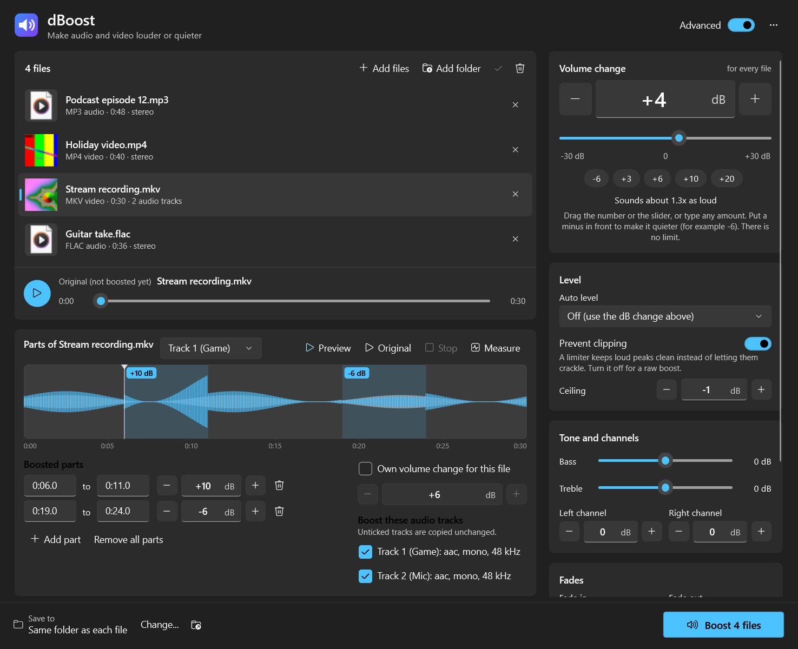

# dBoost

Make audio and video files louder or quieter. Drop in one file or a hundred, audio and video mixed,
choose how many decibels, press **Boost**. Your originals are never changed: every result is saved as a
new file, named like `song (+6 dB).mp3`.



- **Any amount, up or down.** Drag the number, drag the slider, scroll, or type it. Put a minus in front
  to make things quieter (`-6`). There is no limit.
- **Audio and video together.** MP3, WAV, FLAC, M4A, AAC, OGG, Opus, WMA, AIFF and more; MP4, MKV, MOV,
  AVI, WebM, WMV and more. In a video only the sound changes: the picture is copied bit for bit.
- **One exe.** No installer and nothing else to download. FFmpeg is built in.
- **No crackle.** A limiter keeps loud peaks clean when you boost a lot (you can turn it off).

## Download

Get `dBoost.exe` from the [Releases](../../releases) page and run it. Windows 10 or 11, 64-bit.

The first start takes a moment longer while dBoost unpacks its audio engine to `%LOCALAPPDATA%\dBoost`.
The exe is not code-signed, so Windows may say it is from an unknown publisher: choose **More info**,
then **Run anyway**.

## Using it

1. Drop files or whole folders onto the window. You can also click **Add files** (Ctrl+O), **Add
   folder**, or copy files in Explorer and paste them into dBoost (Ctrl+V).
2. Set the change. +6 dB sounds about 1.5x as loud, +10 dB about twice as loud, -6 dB clearly quieter.
3. Press **Boost** (Ctrl+Enter). Each finished file shows **Saved** and its new name: click it to see it
   in Explorer, or drag the row straight into Explorer, a chat app or an editor.

4. Listen to the result. Select a file and press play (or Space, or double-click the file). Videos play
   their sound only. Drag or click the progress bar to jump, and switch between **New file** and
   **Original** to compare the two at the same spot.

Results go next to each original. Click **Change...** at the bottom to save them all into one folder.



## Advanced mode

Switch on **Advanced** (top right) for more control. With it off, dBoost just changes the volume of
whole files.



- **Boost parts of a file.** Drag across the waveform to mark a part and give it its own change. Drag a
  part to move it, drag its edges to resize it, scroll over it to change its dB, right-click to remove
  it. Parts can be made quieter too, and they show up on the waveform as they will sound.
- **Pick tracks.** Videos with several audio tracks (for example game and mic recorded separately in
  OBS) can have just one track boosted. The others are copied unchanged.
- **Own volume per file.** Give one file a different change from the rest.
- **Auto level.** Make every file equally loud (in LUFS: -14 is what YouTube and Spotify use), or as
  loud as possible without clipping.
- **Measure.** Shows a track's loudest peak, its loudness, and how much room there is before it clips,
  with one click to use it.
- **Preview.** Listen to 10 seconds with every change applied, from wherever you click on the
  waveform, and to the original to compare, before saving anything.
- **Clipping control.** Turn the limiter off for a raw boost, or set its ceiling.
- **Tone and channels.** Bass, treble, and separate left and right levels.
- **Fades.** Fade in and fade out.
- **Output format.** Keep each file's format, or convert to MP3, M4A, WAV, FLAC, OGG, Opus, MP4 or MKV,
  and pick the quality. Choosing an audio format for a video saves just its sound.

## Works like a Windows app

- Drag and drop files in and out, paste files with Ctrl+V, or drop files onto `dBoost.exe` itself.
- Optional **Boost volume with dBoost** entry in Explorer's right-click menu and in **Send to**. Turn
  them on in the ... menu (top right). They are per user and need no admin rights. On Windows 11 the
  right-click entry is under **Show more options**.
- One window: opening more files while dBoost is running adds them to the window that is already open.
- Light and dark mode and your accent colour follow Windows.
- Progress shows on the taskbar button, which flashes when a batch finishes in the background.
- Your PC will not fall asleep halfway through a batch.
- FFmpeg runs at low priority, so a game or video playing at the same time stays smooth.
- File thumbnails come from Windows, the same ones Explorer shows.

## Command line

```
dBoost.exe --cli --gain 6 "C:\Music\song.mp3" "D:\Videos"
```

| Option | What it does |
|---|---|
| `--gain <dB>` | Volume change, any amount (default +6). `--gain -6` makes it quieter. |
| `--out <folder>` | Save into this folder instead of next to each file. |
| `--format <f>` | `same` (default), `mp3`, `m4a`, `wav`, `flac`, `ogg`, `opus`, `mp4`, `mkv`. |
| `--bitrate <kbps>` | Quality for lossy formats. Default: about what the original had. |
| `--loudness <LUFS>` | Make every file this loud (for example -14) instead of using `--gain`. |
| `--peak <dB>` | Make every file's loudest peak land here (for example -1) instead of using `--gain`. |
| `--no-limiter` | Let peaks clip instead of limiting them. |

From `cmd.exe`, run it as `start /wait dBoost.exe --cli ...` so the prompt waits for it to finish.

## What "same as original" keeps

- The format and roughly the quality: lossy audio is re-encoded at about the original bitrate (never
  less than 128 kbps), lossless audio stays lossless at the same bit depth.
- Video, subtitles, chapters, album art and tags are copied as they are.
- A few formats can be read but not written (APE, WMA Pro and similar). Those are saved as FLAC if they
  were lossless and as MP3 otherwise, and the file's row says so.

Limits worth knowing:

- You can type any number. Past about 600 dB either way the result cannot change any more (the sound
  is already silent or completely flattened), so dBoost stops there.
- Moving a video into MP4 or MKV leaves its subtitles out.
- An audio-only result keeps one track (the first one you chose to boost).

## Building from source

You need the .NET 10 SDK.

```
powershell -NoProfile -ExecutionPolicy Bypass -File tools\get-ffmpeg.ps1
dotnet test tests\dBoost.Tests
dotnet publish src\dBoost -c Release
```

The exe lands in `bin\publish\dBoost.exe`. Without `get-ffmpeg.ps1` the app still builds, and then uses
an `ffmpeg.exe` placed next to it or found on PATH.

| Folder | What is in it |
|---|---|
| `src/dBoost.Core` | The engine: reading files, building FFmpeg filter chains, boosting, waveforms, previews. |
| `src/dBoost` | The WPF app. |
| `src/dBoost.Ffmpeg` | Carries `ffmpeg.exe` inside the exe. |
| `tests/dBoost.Tests` | Unit tests, plus engine tests that boost real generated audio and video files. |

## License

MIT, see [LICENSE](LICENSE). The bundled FFmpeg is LGPL; see
[THIRD-PARTY-NOTICES.md](THIRD-PARTY-NOTICES.md).
